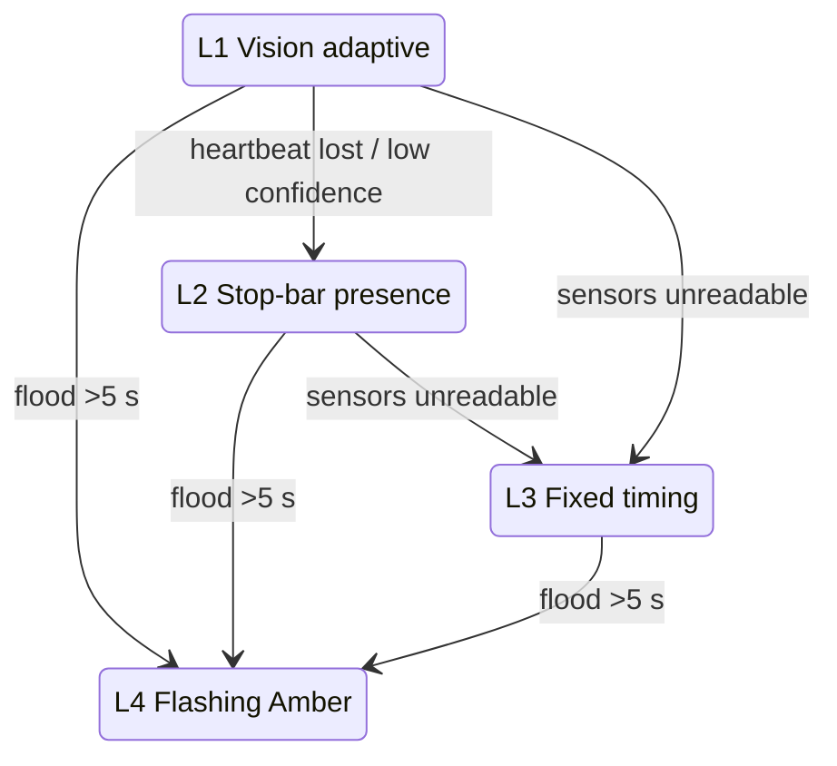

# Degradation Levels

The ESP32 runs a deterministic finite state machine with two phases: Phase 1 is North-South and Phase 2 is East-West. Opposing approaches share a phase. Control degrades through four levels and never stops signaling.

| Level | Name | Entry condition | Behavior |
|---|---|---|---|
| L1 | Vision-driven adaptive | Vision heartbeat healthy | Green extends or truncates early by per-approach weighted PCU demand (CAP-14). |
| L2 | Stop-bar presence fallback | Vision heartbeat lost (3 missed, <3 s) or low frame confidence (rain, darkness, lens debris) | HC-SR04 actuated stop-bar presence with gap-out (below). |
| L3 | Total sensor fault | External sensors disconnected or unreadable | Hardcoded deterministic timing cycle. No freeze, crash or reset. |
| L4 | MDRRMO flood mode | Curb water sensor continuously immersed >5 s (debounced); trigger lands 5–10 s after submersion | Flashing Amber on all approaches, overriding standard phasing. |

## Level 2 logic: actuated stop-bar presence and gap-out

1. **Demand call:** a vehicle at red brings echo distance below the stop-line threshold (D < D_stopline), which places a service call for that phase.
2. **Passage-time extension:** green extends while presence is sensed continuously, up to T_max_green.
3. **Gap-out:** if the stop bar stays clear for more than 3.0 s, green terminates early and the controller cycles to the opposing phase.

An ultrasonic sensor at curb level senses only the lead vehicle. Vehicles behind it are acoustically shadowed, so Level 2 measures **presence, not queue length**. Calling it queue measurement is invalid.

## Manual overrides (dashboard, CAP-5)

- **Flashing Amber:** forced caution mode.
- **Evacuation corridor:** continuous green on the phase the operator picks, NS or EW. This is reserved exclusively for manual MDRRMO override; automatic flood mode only ever goes to Flashing Amber.
- Every override asks for confirmation before it activates. M1 has no login.
- **Priority (assumption):** a manual override outranks every automatic level, L4 included.

## Diagram

Recovery transitions back to higher levels are unspecified (open question in the kernel).

## Unspecified values (kernel open questions)

Min green, T_max_green, yellow duration, Level 3 cycle timings, D_stopline, all-red clearance, recovery conditions and delays.
