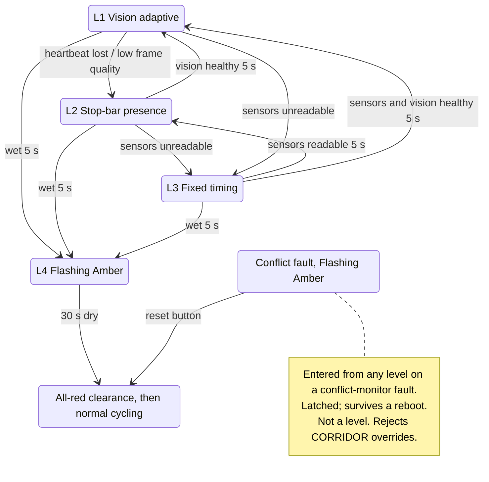

# Degradation Levels

The ESP32 runs a deterministic finite state machine with two phases: Phase 1 is North-South and Phase 2 is East-West. Opposing approaches share a phase. Control degrades through four levels and never stops signaling.

## Phase cycle and signal safety

- **Cycle:** NS green → NS yellow → all-red clearance → EW green → EW yellow → all-red clearance.
- Every phase change passes through the all-red clearance.
- **Conflict monitor:** the firmware watches for conflicting greens. A conflict fault forces Flashing Amber on all approaches and latches:
  - Only the reset push button on the controller box clears it (`hardware.md`). The dashboard cannot.
  - A reboot does not clear it: the firmware keeps the fault flag in NVS beside the boot counter.
  - After a reset, the cycle resumes at an all-red clearance, unless a Flashing Amber override is in effect.
- A conflict fault is **not** a degradation level. The controller keeps reporting its automatic level, and the fault displays as FAULT, never as L4 (spine, MQTT contract v1).

## Timing values (diorama)

These suit the 60 × 60 cm diorama and the pitch; a real junction needs longer ones. Squad A's demo timings set the fixed green, yellow and all-red.

| Value | Setting | Applies to |
|---|---|---|
| Fixed green | 10 s | L3 |
| Min green | 5 s | L1, L2 |
| Max green (T_max_green) | 20 s | L1, L2 |
| Yellow | 3 s | all levels |
| All-red clearance | 2 s | all levels |
| Gap-out | stop bar vacant for more than 3 s | L2 |
| D_stopline | 8 cm: one 7.5 cm lane plus margin, matching the IR module's ≈7 cm trigger. Squad A confirms it on the built diorama | L2 (HC-SR04) |
| Vision loss | 3 missed heartbeats (<3 s) | L1 → L2 |
| Recovery hold | 5 s healthy | climbing back a level |
| Flood entry / exit | 5 s wet / 30 s dry | L4 |
| Corridor hold after link loss | 60 s | overrides |

| Level | Name | Entry condition | Behavior |
|---|---|---|---|
| L1 | Vision-driven adaptive | Vision heartbeat healthy | Green extends or ends early by per-approach weighted PCU demand (CAP-14), between min and max green. |
| L2 | Stop-bar presence fallback | Vision heartbeat lost (3 missed, <3 s), or the vision node reports low frame quality (rain, darkness, lens debris) | Stop-line presence with gap-out (below). The HC-SR04 on North serves NS; the IR module on East serves EW. |
| L3 | Total sensor fault | External sensors disconnected or unreadable (below) | Fixed cycle on the demo timings. No freeze, crash or reset. |
| L4 | MDRRMO flood mode | Water sensor wet continuously for 5 s (debounced); the trigger lands 5–10 s after submersion | Flashing Amber on all approaches, overriding standard phasing. After 30 s dry, normal cycling resumes at an all-red clearance. |

## Level 2 logic: actuated stop-bar presence and gap-out

1. **Demand call:** a vehicle waiting at red is sensed at the stop line, either as an HC-SR04 echo distance below D_stopline (8 cm, North) or as the IR module's output going LOW (East). This places a service call for that phase.
2. **Passage-time extension:** green extends while presence is sensed continuously, up to max green (20 s).
3. **Gap-out:** once min green (5 s) has run, if the stop bar stays clear for more than 3.0 s, green ends early, and the controller cycles to the opposing phase through yellow and the all-red clearance.

Each sensor sits at curb level and senses only the lead vehicle. Vehicles behind it are shadowed, so Level 2 measures **presence, not queue length**, and calling it queue measurement is invalid.

## Detecting an unplugged sensor (Level 3)

- **HC-SR04:** repeated echo timeouts (each read times out at ≈25 ms).
- **IR module:** GPIO 19 uses a pull-down, so an unplugged module reads as presence that never clears, and the firmware treats that as unreadable. Squad A sets the stuck-presence threshold above the longest legitimate presence; it is a firmware internal (spine AD-17).

## Recovery

- Once the condition that lowered the level has been clear for 5 s straight, the controller climbs back to the highest level its healthy inputs support. The switch happens at the next all-red clearance, so a green is never cut short.
  - **L2 → L1:** vision heartbeats on time with `ok: true` for 5 s.
  - **L3 → L2:** stop-line sensors readable for 5 s while vision is still down. **L3 → L1:** sensors readable and vision healthy for 5 s.
- Dropping takes under 3 s and climbing takes 5 s, so a half-covered lens doesn't flicker between levels.
- L4 exits after 30 s dry, at an all-red clearance.

## Manual overrides (dashboard, CAP-5)

- **Flashing Amber:** forced caution mode.
- **Evacuation corridor:** continuous green on the phase the operator picks, NS or EW. This is reserved exclusively for manual MDRRMO override; automatic flood mode only ever goes to Flashing Amber.
- Every override asks for confirmation before it activates. There is no operator login: overrides come only from the edge laptop (kernel Constraints).
- **Priority (assumption):** a manual override outranks every automatic level, L4 included.
- **Conflict fault outranks overrides (decision):** while a conflict fault is active, the controller rejects `CORRIDOR` with reason `CONFLICT_FAULT` and accepts `FLASHING_AMBER` and release. A fault ends a corridor already in effect, and the corridor does not resume after the reset; a Flashing Amber override survives the reset. The priority assumption still holds, because a conflict fault is not a level.
- **When the link drops (decision):** the ESP32 sees only its own command link: its broker connection, or the serial bridge while the CAP-15 fallback is in use (spine AD-18).
  - Flashing Amber holds until released.
  - A corridor holds for 60 s after the command link is lost, then returns to automatic through yellow and the all-red clearance. A shorter drop changes nothing, and a working serial fallback counts as a link.
  - The dashboard learns of the release from `state.override` when the link returns (spine AD-7).
- The override lifecycle, timeouts and when the dashboard shows an override as active are set in spine AD-7.

## Diagram

Upward transitions take effect at the next all-red clearance.
